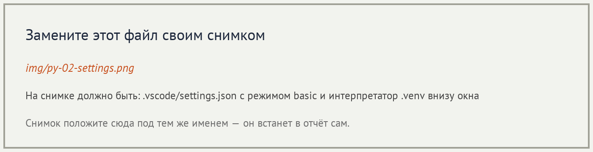
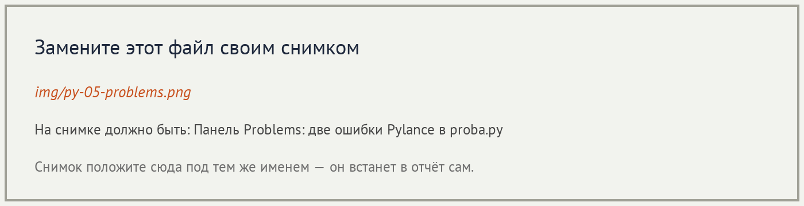
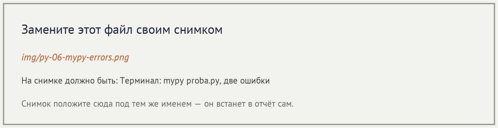

# Отчёт · Проверка типов: Pylance и mypy

**Студент:** Марущак Сергей, группа РПО 25/2

## 1. Подготовка




## 2. Проверка в редакторе

```python
from app.utils.formatter import format_kopeks, format_title

format_title(40)
format_kopeks("1250")
```


Разбор сообщения:

| Часть сообщения | Что означает |
|---|---|
| `Argument of type "Literal[40]"` | в вызов передано число 40, и проверка считает его целым литералом, а не строкой |
| `parameter "text" of type "str"` | первый параметр `format_title` объявлен как строка |
| `reportArgumentType` | правило Pylance: тип аргумента не совпал с типом параметра |



## 3. Проверка в терминале

```text
mypy 1.15.0 (compiled: yes)
proba.py:3: error: Argument 1 to "format_title" has incompatible type "int"; expected "str"  [arg-type]
proba.py:4: error: Argument 1 to "format_kopeks" has incompatible type "str"; expected "int"  [arg-type]
Found 2 errors in 1 file (checked 1 source file)
```



```text
Success: no issues found in 1 source file
```

Исправленные вызовы: `format_title("Итог")` и `format_kopeks(1250)`.

## 4. Проект без аннотаций

| Этап | Итог `mypy app` |
|---|---|
| исходно | `Found 17 errors in 10 files (checked 15 source files)` |
| после `utils` | `Found 12 errors in 7 files (checked 15 source files)` |
| после `domain` | `Found 8 errors in 5 files (checked 15 source files)` |
| после `services` | `Found 1 error in 1 file (checked 15 source files)` |
| после `ui` | `Success: no issues found in 15 source files` |

Модуль до и после — `app/utils/formatter.py`:

```python
def format_kopeks(kopeks):
    return f"{kopeks / 100:,.2f} ₽".replace(",", " ").replace(".", ",")


def format_title(text, width=40):
    return text.center(width, "=")
```

```python
def format_kopeks(kopeks: int) -> str:
    return f"{kopeks / 100:,.2f} ₽".replace(",", " ").replace(".", ",")


def format_title(text: str, width: int = 40) -> str:
    return text.center(width, "=")
```

```text
Success: no issues found in 15 source files
............                                                             [100%]
12 passed in 0.02s
=========== Смена <дата запуска> ===========
Петрова Анна                  2 480,50 ₽
Иванов Пётр                   1 685,00 ₽
Сидоров Илья                    772,00 ₽
=========== Итого 4 937,50 ₽ ===========
```

Дата в заголовке — день запуска `python main.py`. Сумма итога от даты не зависит.


## 5. Выводы

Pylance подчёркивает неверный аргумент сразу в редакторе, mypy пишет то же
несовпадение типов в терминале и ставит код `arg-type`. Пока у функции нет
аннотации, mypy при `disallow_untyped_defs = true` ругается кодом
`no-untyped-def` и не может проверить вызовы. После аннотаций во всех
модулях `app` проверка пустая, двенадцать тестов проходят, итог отчёта
остаётся `4 937,50 ₽`. Проверка типов не запускает программу и не ловит
неверный расчёт, если типы аргументов совпали.
