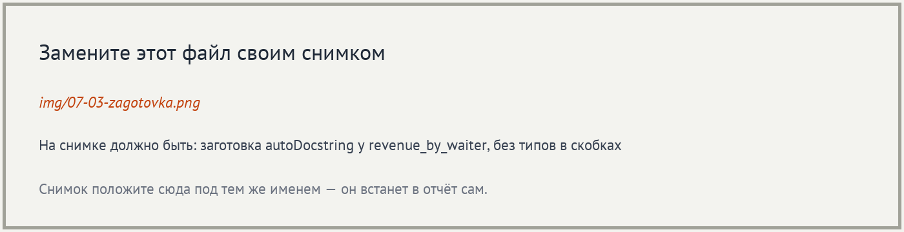
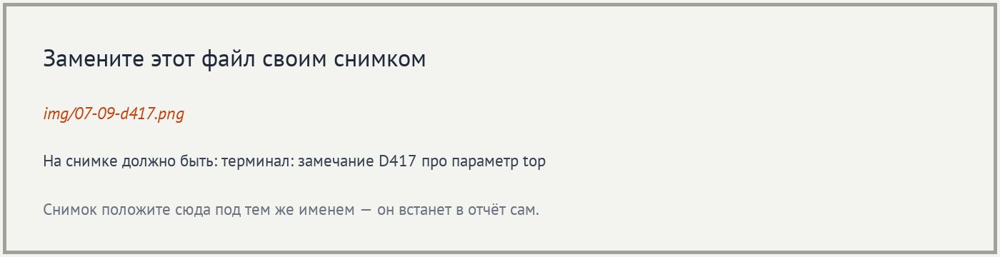

# Отчёт · Докстринги в VS Code: генератор и проверка

**Студент:** Марущак Сергей, группа РПО 25/2
**Номер в журнале:** ___, вариант шагов 7 и 10: ___, модуль `___`

Работа выполнена на втором архиве проекта «Отчёт кафе»
(`lesson_07/otchet-kafe-start`), глава 4.10.

## 1. Расширения

Установлены расширения `njpwerner.autodocstring` и `charliermarsh.ruff`.
Автор autoDocstring на карточке расширения: Nils Werner. Издатель Ruff: Astral Software.


## 2. Настройки проекта

Настройки генератора записаны в файл `.vscode/settings.json`. Он лежит внутри проекта
и попадает в репозиторий, поэтому заготовка у всех, кто откроет проект,
будет одинаковой.


Формат заготовки — `google-notypes`. С проверкой Ruff он согласуется, потому что
в `pyproject.toml` записано `convention = "google"`. Настройка
`startOnNewLine` оставлена `false`: иначе Ruff выдаст замечание `D212`.

## 3. Заготовка генератора

Генератор вызван у функции `revenue_by_waiter` способом: пустая строка под подписью и команда Generate Docstring.



В заготовке разделы `Args`, `Raises` и `Returns`. Раздел `Raises:` появился,
потому что в теле функции есть `raise ValueError`. Типов в скобках нет, потому что
выбран формат `google-notypes`.

## 4. Заполненный докстринг


Краткая строка: «Считает выручку каждого официанта и отдаёт её по убыванию суммы.». Параметр `top` описан так: «Сколько официантов оставить, начиная с самой большой выручки. Ноль означает всех.».

## 5. Сниппет

Сниппет записан в файл `.vscode/python.code-snippets`. Его название — «Докстринг в формате Google», слово для вызова —
`dsg`. Им вставлен докстринг функции `load_orders`.


Имя параметра `path` в сниппет вписано вручную: сниппет вставляет один и тот же
текст для любой функции и подпись не читает.

## 6. Проверка всего пакета

Команда `ruff check app --output-format=concise` закончилась строкой
`Found 31 errors.`


Чаще других в выводе два кода. `D100` означает: нет докстринга у модуля.
`D103` означает: нет докстринга у публичной функции.

## 7. Замечания в редакторе

Модуль моего варианта — `___`. В панели Problems у него ___ замечания.
Источник у каждого замечания — `Ruff`.


## 8. Модуль orders.py без замечаний

Докстринг модуля `orders.py`: «Заказы смены: чтение файла, выручка по официантам и сортировка.».
Докстринг `sort_orders_in_place`: «Сортирует заказы по сумме в копейках, от большей к меньшей.».


## 9. Опыт с D417

После удаления строки про `top` проверка вывела:
`D417 Missing argument description in the docstring for revenue_by_waiter: top`.



Правило D417 сравнивает раздел `Args:` с подписью функции. Остальные правила
из вывода проверяют, есть ли докстринг и как он оформлен. После опыта
строка про `top` возвращена.

## 10. Модуль моего варианта

До работы проверка модуля `___` выводила `Found ___ errors.`, после —
`All checks passed!`. В пакете `app` осталось `Found ___ errors.`


Докстринг одной из функций модуля:

```python
___
```

## 11. Итог

Ruff проверяет, что докстринг есть, оформлен по правилам и перечисляет
все параметры подписи. Верность описания по смыслу Ruff не проверяет:
докстринг с текстом `_description_` для него в порядке.

Не получилось: снять свои снимки окна VS Code. Номер в журнале и модуль варианта пока не вписаны.

ИИ: использовался для проверки вывода Ruff и заполнения отчёта
